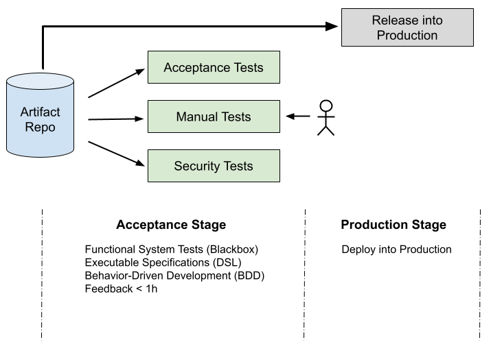

# Introduction to Continuous Delivery

> **Continuous Delivery (CD)** builds upon Continuous Integration. CI tells us
> whether our code **works technically**. CD goes further and makes sure
> that every change is evaluated until we know whether it is **ready for
> release**, so that our software is **always in a releasable state**.

_Figure: Continuous delivery part of the pipeline (Farley, 2021)_

## The Deployment Pipeline

The **Deployment Pipeline** is the automated path of every change from
the commit to production. Continuous Integration covers its first part,
Continuous Delivery the rest.

The goal of the Deployment Pipeline is not to prove that our software
is good, but to **find the reasons why a Release Candidate is not good
enough**, as early and as cheaply as possible. Each stage increases our
confidence. If any stage fails, the Release Candidate is rejected and
does not progress any further.

> **The Deployment Pipeline is the only route to Production.**

Every change, even an urgent bug fix or a change of the configuration,
takes this route. Therefore, the pipeline must be **fast and reliable**
enough to be used in an emergency, too.

## From the Commit Stage to the Acceptance Stage

The input of Continuous Delivery is the **Release Candidate (RC)**,
which was created by a successful Commit Stage and stored in the
**Artifact Repository**.

From now on, we **never build the software again**. Every following
stage works with **exactly the same bits and bytes** of the Release
Candidate. Only the environment specific configuration differs between
the test environments and production. If we rebuilt the software for
every stage, we could never be sure that we test what we release.

The focus changes as well:

|             | Commit Stage (CI)               | Acceptance Stage (CD)       |
|-------------|---------------------------------|-----------------------------|
| Question    | Does the code work as expected? | Does it do what users want? |
| Perspective | developer (technical)           | external user (functional)  |
| Tests       | unit tests, static analysis     | acceptance, system tests    |
| Environment | build environment               | production-like environment |
| Feedback    | < 5 minutes                     | < 1 hour                    |
| Confidence  | > 80%                           | ready for release           |

## Acceptance Stage

In the Acceptance Stage, we evaluate the Release Candidate from the
**perspective of the external users** of the system:

* **Acceptance Tests:** These are functional system tests (black box 
    tests). They interact with the system only through its **public 
    interfaces**.

    The best acceptance tests are written as executable specifications 
    in a **Domain Specific Language (DSL)**, which describes **WHAT** 
    the system should do, not **HOW** it does it. This is the idea of
     **Behavior-Driven Development (BDD)**.

* **Security Tests:** We check the Release Candidate for known
    vulnerabilities and attack the running system, for example with
    **penetration tests**.

* **Manual Tests:** Humans are bad at repeating the same tests, but good
    at **exploring** a system. Manual tests are used for exploratory
    testing and usability, not for regression tests, which are automated.

The Acceptance Stage should provide feedback **within one hour**. It
takes longer than the Commit Stage, but every Release Candidate which
passes it is a candidate for production.

## Production Stage

The last stage of the Deployment Pipeline **releases the Release
Candidate into production**. We have already deployed this version
many times into production-like environments, so the deployment itself
is a routine, automated procedure.

We distinguish two ways to release:

* **Continuous Delivery:** Every Release Candidate which passes all
    stages **could** be released. The decision **when** to release is a
    **business decision** (risks, safety, customers, regulations).

* **Continuous Deployment:** Every Release Candidate which passes all
    stages **is** released automatically, without human intervention.

Release strategies like **Blue/Green Deployment** or **Canary Releases**
manage the transition from the old to the new version, and the
**feedback from production** (monitoring) closes the loop to the
developers.

## Continuous Delivery for Embedded Systems

For embedded systems, Continuous Delivery faces some additional
challenges:

* **Hardware:** The software runs on a **target platform** with another
    CPU architecture (for example ARM), other peripherals and limited
    resources. A production-like environment therefore includes the real
    hardware, or at least a simulation of it (emulators like QEMU,
    simulated sensors).

* **Hardware in the Loop (HIL):** Acceptance tests are executed on the
    target hardware, which is connected to the CI infrastructure, for
    example as a Jenkins agent on a Raspberry Pi.
    Test equipment stimulates the inputs and measures the outputs of the
    device.

* **Deployment:** There is often no server we can simply update.
    Devices are deployed in the field, sometimes without a network
    connection. Updates are delivered as **firmware images** or
    **Over-the-Air (OTA) updates**.

* **Rollback:** A failed update must not turn a device into a "brick".
    Many embedded systems therefore use **two partitions** (A/B update):
    the new version is installed into the inactive partition, and the
    device switches back to the old one if the new version doesn't
    start. This is the embedded variant of a Blue/Green Deployment.

* **Safety and regulations:** In domains like automotive, medical or
    industrial systems, a release may require documented evidence,
    reviews and certification. Here the pipeline helps, too: it produces
    reproducible builds and **automatically documented test results**
    for every Release Candidate. The release itself is then a business
    decision, which is exactly what Continuous Delivery allows.

## Essential CD Practices

* The Deployment Pipeline is the **only route to production**.

* **Build binaries only once**, and promote the same Release Candidate
    through all stages.

* **Deploy the same way to every environment**, using the same
    automated deployment mechanism for test environments and production.

* Keep environment specific **configuration separate** from the Release
    Candidate.

* **Smoke test** every deployment.

* Test in **production-like environments**.

* **Automate** everything that is repeated: build, deployment, tests,
    configuration of environments.

* If any stage fails, **stop the line**: fix the problem before
    anything else.

* Keep the software **always releasable**, and make releasing a
    business decision, not a technical event.

## References

* Jez Humble, Davis Farley. **Continuous Delivery**. Addison-Wesley, 2010
* Davis Farley. **Continuous Delivery Pipelines**. Independently published, 2021
* [continuousdelivery.com](https://continuousdelivery.com/)

_Egon Teiniker, 2025-2026, GPL v3.0_
