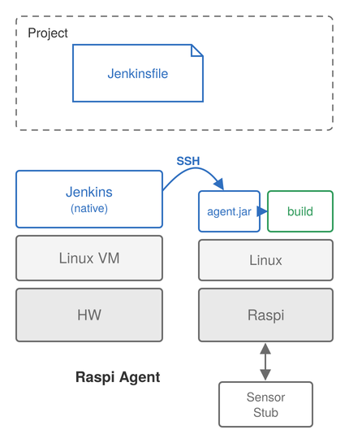

# Example: Jenkins and Raspberry Pi 5 Agent

The Jenkins server connects to a Raspberry Pi via **SSH** and starts the
`agent.jar` there. The build runs on the **target hardware**, which is
connected to a sensor stub.




## Setup Jenkins

Start the native Jenkins service:

```bash
$ sudo systemctl start jenkins
$ sudo systemctl status jenkins	
```

Access the Jenkins Web GUI:

```bash
URL: http://localhost:9000/
```


## Setup Java on Raspi 5

When you use SSH launch, Jenkins connects to the Raspberry Pi, copies over
the agent program `remoting.jar`, and then runs it with Java:

```bash
$ java -jar remoting.jar
```

So even though the connection starts with SSH, the actual agent process is 
still a Java application. Without Java, Jenkins cannot start the agent.

Therefore, we have to **install the Java Development Kit (JDK)**:

```bash
$ sudo apt update
$ sudo apt install openjdk-25-jdk 
```


## Setup Raspberry Pi Agent

Try to **connect to the Raspi via SSH**:

```bash
$ ssh <username>@<ip address>
password: <password>

$ exit 
```

With SSH connectivity verified, we can proceed to **configure the Jenkins agent**:

**Add a new Jenkins agent** (node):

* On the Jenkins web UI:	
	- Go to `(Gear) Manage Jenkins / Nodes`
		- Click `[New Node]`
			- Node name: raspi-5
			- Choose “Permanent Agent” 
			- `[Create]`

	- On the configuration screen:
		- Number of executors: 1
		- Remote root directory: `/home/student`
		- Labels: 
		- Usage: `Only build jobs with label expressions matching this node`
		- Launch method: `Launch agents via SSH`
			- Host: <ip address>
			- Credentials: <username> / <password>
				- Add Credentials
					- Domain: Global credentials 
					- Kind: Username with password 
					- Scope: Global 
			- Host Key Verification Strategy: Manually trusted key Verification Strategy
				- Check: `Require manual verification of initial connection`
		- Availability: `Keep this agent online as much as possible` 
		- `[Save]`

	- Go to the Nodes overview, ensure your new Node `raspi-5` is listed.


## Configure Jenkins Job

We use the `jenkins-pipeline-cxx` with `Jenkinsfile-agent-raspi`:

* New Item
    - Enter an item Name "**C++ Pipeline (Raspi Agent)**"
	- Pipeline
    - Description (optional)
    - Build Triggers 
	    - Poll SCM: `H/2 * * * *`
    - Pipeline / Definition: 
      - Pipeline: Pipeline Script from SCM: 
        - SCM: Git 
        - Repository URL: `https://github.com/teiniker/jenkins-pipeline-cxx.git` 
        - Branches to build: `*/main` 
      - Script Path: **Jenkinsfile-agent-raspi**


After running the build on the Raspi5 agent, we can **download the executable and analyze it**:

```bash
$ file workspace/C++\ Pipeline\ \(Raspi\ Agent\)/file_service/build/test/test 

workspace/C++ Pipeline (Raspi Agent)/file_service/build/test/test: ELF 64-bit LSB pie executable, ARM aarch64, version 1 (GNU/Linux), dynamically linked, interpreter /lib/ld-linux-aarch64.so.1, BuildID[sha1]=7c3eaffde984cc1d987a7c9b8d86ae0fa77955b6, for GNU/Linux 3.7.0, with debug_info, not stripped
```

As we can see, it is an **ARM aarch64 binary**.


## Any vs. Raspberry Pi

The `jenkins-pipeline-cxx` repository contains pipelines which only
differ in the `agent` directive:

```groovy
// Jenkinsfile
pipeline
{
    agent any
    ...
}
```

```groovy
// Jenkinsfile-agent-raspi
pipeline
{
    agent { label 'raspi-5' }
    ...
}
```

* `agent any`: Run the pipeline on **any node** with a free executor.
    In our setup, this is usually the built-in node, which means the
    Linux VM with the Jenkins controller.

* `agent { label 'raspi-5' }`: Run the pipeline **only** on the node
    `raspi-5`. The name of a node is always also one of its labels, so
    this works although we left the `Labels` field empty.

In contrast to the `linux-vm` agent, the Raspberry Pi is a **separate
computer** with its own CPU, operating system and installed tools. The
`info` stage of `Jenkinsfile-agent-raspi` shows this:

```
Running on raspi-5 in /home/student/workspace/C++ Pipeline (Raspi Agent)
+ hostname
ece-rpi5-kit66
+ pwd
/home/student/workspace/C++ Pipeline (Raspi Agent)
```

A build with `agent any` on the VM reports the host name `debian13` and
the workspace `/var/lib/jenkins/workspace/...` instead.

### Different CPU Architecture

The most important difference for embedded systems is the **CPU
architecture**. The VM is an `x86_64` machine, the Raspberry Pi 5 an
`aarch64` (ARM 64 bit) machine. The same `cmake .. && make` produces
different binaries:

```bash
# Built on the VM (x86_64)
$ file .../file_service/build/test/test
... ELF 64-bit LSB pie executable, x86-64, version 1 (SYSV), dynamically linked, ...

# Built on the Raspberry Pi (archived by Jenkins on the controller)
$ file "/var/lib/jenkins/jobs/C++ Pipeline (Raspi Agent)/builds/2/archive/file_service/build/test/test"
... ELF 64-bit LSB pie executable, ARM aarch64, version 1 (GNU/Linux), dynamically linked, ...
```

The ARM binary can't be executed on the VM:

```bash
$ "/var/lib/jenkins/jobs/C++ Pipeline (Raspi Agent)/builds/2/archive/file_service/build/test/test"
bash: ...: cannot execute binary file: Exec format error
```

With the Raspberry Pi agent, the code is **compiled natively** (no cross
compiler needed) and the tests run **on the target hardware**:

```
+ ./test/test
Running main() from /home/student/Downloads/googletest/googletest/src/gtest_main.cc
[==========] Running 2 tests from 1 test suite.
...
[  PASSED  ] 2 tests.
```

So the tests find errors which only occur on the target, for example
problems with the data type sizes, the byte order or the libraries of
the target system. Tests can also access the **hardware** of the
Raspberry Pi (GPIO, I2C, SPI, connected sensors), which is impossible on
the VM. This is the basic idea of **Hardware in the Loop (HIL)** testing.

The build results remain on the Raspberry Pi. Only the files listed in
`archiveArtifacts` are copied to the controller.

### Who Starts the Agent?

The Raspberry Pi agent is launched in the **opposite direction** than
the `linux-vm` agent:

|                 | `linux-vm` agent             | `raspi-5` agent            |
|-----------------|------------------------------|----------------------------|
| Launch method   | connect it to the controller | via SSH                    |
| Connection      | agent to controller          | controller to agent        |
| Protocol        | WebSocket                    | SSH (stdin/stdout)         |
| Started by      | us, in a terminal            | Jenkins, automatically     |
| Agent program   | downloaded by us             | copied by Jenkins (SFTP)   |
| After a failure | we start it again            | Jenkins reconnects         |

The agent log (`Manage Jenkins / Nodes / raspi-5 / Log`) shows what
Jenkins does:

```
[SSH] Opening SSH connection to 10.225.32.66:22.
[SSH] Authentication successful.
[SSH] The remote user's environment is:
...
[SSH] Starting sftp client.
[SSH] Copying latest remoting.jar...
[SSH] Copied 1,417,030 bytes.
[SSH] Starting agent process: cd "/home/student" && java  -jar remoting.jar -workDir /home/student -jar-cache /home/student/remoting/jarCache
...
Communication Protocol: Standard in/out
This is a Unix agent
Agent successfully connected and online
```

1. Jenkins connects to the Raspberry Pi with the stored credentials.
2. It copies the agent program `remoting.jar` (the same program as
    `agent.jar`) into the remote root directory.
3. It starts the agent with `java -jar`. That's why Java must be
    installed on the Raspberry Pi.
4. Controller and agent communicate over the **standard input and
    output** of the SSH session.

### The Environment of an SSH Agent

The agent runs in a **non-interactive** SSH session of the user
`student`. The log shows its environment:

```
HOSTNAME=ece-rpi5-kit66
HOSTTYPE=aarch64
USER=student
PATH=/usr/local/bin:/usr/bin:/bin:/usr/games
...
```

The `PATH` is the minimal default. A non-interactive session doesn't
execute the parts of `~/.bashrc` which are only meant for interactive
shells (Debian's `.bashrc` returns immediately in this case). Tools
which we add to the `PATH` in `~/.bashrc` are therefore **not found** in
a build, although they work in our own SSH session. We install the tools
into standard locations (`/usr/local`), use absolute paths, or set the
`PATH` in the pipeline:

```groovy
environment {
    PATH = "/opt/mytool/bin:${env.PATH}"
}
```

### Network and Security

* **Availability:** The Raspberry Pi must be switched on and reachable
    over the network. The node configuration contains its **IP address**
    (`10.225.32.66`). If the address changes (for example via DHCP), the
    agent goes offline and labeled builds wait in the queue. A fixed IP
    address or a host name is more robust.

* **Host key verification:** With
    `Manually trusted key Verification Strategy`, Jenkins accepts the
    host key of the Raspberry Pi only after we confirm it once in the
    web UI. If we choose `Non verifying Verification Strategy`, the log
    warns:

    ```
    [SSH] WARNING: SSH Host Keys are not being verified. Man-in-the-middle attacks may be possible against this connection.
    ```

    Then another machine could pretend to be the Raspberry Pi and
    receive our source code and credentials.

* **Credentials:** For a permanent setup, an **SSH key** (credentials
    kind `SSH Username with private key`) is preferable to a password.


_Nicoletta Kähling, Egon Teiniker, 2025-2026, GPL v3.0_    


