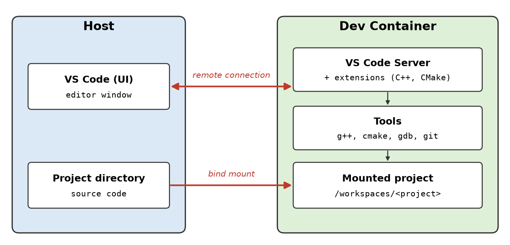
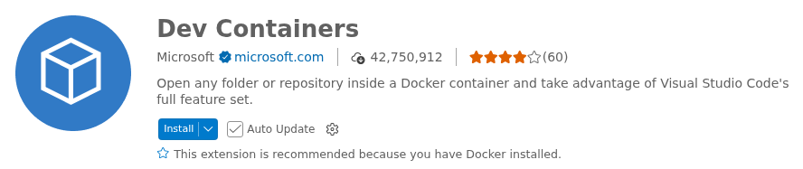

# Dev Containers

A **Development Container** (Dev Container) is a Docker container that is
used as a complete **development environment**. Instead of installing
compilers, build tools, debuggers and libraries on every developer machine,
these tools are described once in a Dockerfile and run inside a container.

The configuration is stored in the project itself, in a `.devcontainer/`
directory:

* `Dockerfile` (or a reference to an existing image): describes the
    **tools** which are available in the container.
* `devcontainer.json`: describes **how** the container is created and
    configured, for example which editor extensions are installed or which
    commands run after the container has been created.

Because the configuration is versioned together with the source code, every
developer who checks out the project gets exactly the same environment.

The format of `devcontainer.json` is an open specification
([containers.dev](https://containers.dev/)). It is supported by VS Code,
GitHub Codespaces, JetBrains IDEs and the `devcontainer` command line tool.

Advantages of Dev Containers:

* **Reproducible environment**: All developers use the same compiler
    version, the same CMake version and the same libraries.
* **Fast onboarding**: A new team member only needs Docker and an editor.
    The first start of the container sets up everything else.
* **No conflicts on the host**: Different projects can use different
    toolchains (e.g. different GCC versions or cross compilers) without
    affecting each other or the host system.
* **Same environment in CI**: The same image can be used in the CI pipeline,
    so "it works on my machine" also means "it works on the build server".


## Docker Image vs. Dev Container

In the `docker-cxx` example, the Dockerfile copies the source code into the
image and compiles it during `docker build`. The result is an image that
contains the finished program.

A **Dev Container** uses a container in a different way:

* The image contains only the **tools** (compiler, CMake, debugger, git).
* The source code stays on the **host** and is mounted into the container.
* VS Code runs inside the container: editing, building, debugging and the
    terminal all use the tools from the container.

Every developer (and the CI pipeline) therefore uses exactly the same
toolchain, independent of what is installed on the local machine.

| | `docker-cxx` | `dev-container-cxx` |
|---|---|---|
| Purpose | Run the program | Develop the program |
| Source code | Copied into the image | Mounted from the host |
| Build | During `docker build` | Inside the running container |
| Changes to code | Rebuild the image | Rebuild the program only |


## Using Dev Containers in VS Code

VS Code splits itself into two parts when working with a Dev Container:

* The **user interface** (editor window) runs on the host.
* The **VS Code Server** runs inside the container. It accesses the files,
    runs the terminal, the build and the debugger, and hosts the extensions
    listed in `devcontainer.json`.



### Setup

We need three things on the host:

1. **Docker**
    * Linux: Docker Engine. To use Docker without `sudo`, add the user to
        the `docker` group and log in again:
        ```bash
        $ sudo usermod -aG docker $USER
        ```
    * Windows and macOS: Docker Desktop (on Windows with the WSL 2 backend).

    Check that Docker works:
    ```bash
    $ docker run --rm hello-world
    ```

2. **VS Code**

3. The VS Code extension **Dev Containers**
    (`ms-vscode-remote.remote-containers`). Install it from the Extensions
    view (`Ctrl+Shift+X`) or from the command line:
    ```bash
    $ code --install-extension ms-vscode-remote.remote-containers
    ```



After the installation, a **Remote Indicator** appears in the bottom left
corner of the status bar. Clicking on it shows all Dev Container commands.

### Working with Dev Containers

All commands are available in the command palette (`Ctrl+Shift+P`) and
start with **Dev Containers:**.

**Open a project in a container**:
Open a project directory which contains a `.devcontainer/` directory.
VS Code detects the configuration and offers **Reopen in Container**
(or use the command **Dev Containers: Reopen in Container**).

VS Code then performs the following steps:

1. Build the image from the Dockerfile (only the first time, later starts
    reuse the image).
2. Create and start the container and mount the project directory to
    `/workspaces/<project>`.
3. Run the `postCreateCommand` (only after the container has been created).
4. Install the VS Code Server and the extensions in the container.

The Remote Indicator then shows the name of the Dev Container.

**Work inside the container**:
Every terminal opened in VS Code (**Terminal > New Terminal**) runs inside
the container. Building, running and debugging use the tools from the
container:

```bash
$ cmake -S . -B build
$ cmake --build build
$ ./build/hello
```

**What is persistent?**:
* Files in the **project directory** are stored on the host (mount). They
    survive when the container is removed.
* Everything else in the container (e.g. a package installed with
    `apk add` in the terminal) is **lost** when the container is rebuilt.
    Tools which are needed permanently belong in the Dockerfile.

**Change the configuration**:
After changing the `Dockerfile` or `devcontainer.json`, the container must
be rebuilt with **Dev Containers: Rebuild Container**. Use
**Dev Containers: Rebuild Without Cache** to also rebuild all image layers.
Changes to the source code never require a rebuild of the container.

**Create a new configuration**:
**Dev Containers: Add Dev Container Configuration Files...** creates a
`.devcontainer/` directory from a list of predefined templates (e.g. C++,
Python).

**Leave the container**:
**Dev Containers: Reopen Folder Locally** switches back to the host. The
container is stopped, but the container and the image remain on the host:

```bash
$ docker container ls -a
$ docker image ls
```


## References

* [YouTube (Visual Studio Code): Run Your AI Coding Agent in Dev Containers - Complete Beginner's Guide](https://youtu.be/w3kI6XlZXZQ?si=E65hB18XnYtQqEd3)

* [Development Containers](https://containers.dev/)
* [Dev Container metadata reference](https://containers.dev/implementors/json_reference/)
* [VS Code: Developing inside a Container](https://code.visualstudio.com/docs/devcontainers/containers)
* [VS Code: Dev Containers tutorial](https://code.visualstudio.com/docs/devcontainers/tutorial)


*Egon Teiniker, 2025-2026, GPL v3.0*
