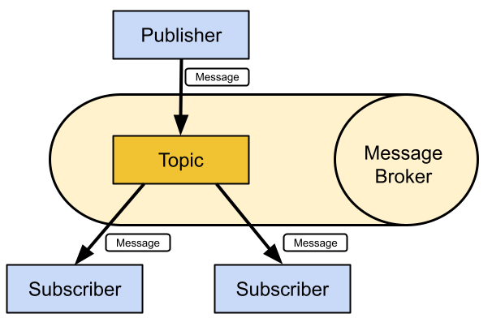

# Publisher-Subscriber Pattern

> In the publish-subscribe pattern, a client that publishes a message is decoupled 
> from the other client or clients that receive the message.

The publish-subscribe pattern requires a server, also known as a **broker**. 
All the clients establish a connection with the broker.

A client that sends a message through the server is known as the **publisher**. 

The Broker filters the incoming messages and distributes them to the clients that 
are interested in that type of received messages. 

Clients that register to the server as interested in specific types of messages are 
known as **subscribers**.

A **topic** is a named logical channel, and it is also referred to as a channel or 
subject. The server will send subscribers only messages published to topics to which 
they are subscribed.

The data for a message is known as the **payload**. A message includes the topic to 
which it belongs and the payload.

The **publisher-subscriber architecture** results in the following properties:

* Publishers and subscribers are **decoupled in space** because they don't know each other. 

* Publishers and subscribers are **decoupled in time** because don't have to run at the same time. 
    The publisher can publish a message and the subscriber can receive it later. 

* The publish operation isn't synchronized with the receive operation.

The publisher can **send a message as an asynchronous operation** to avoid being blocked 
until the Broker receives the message.

A publisher that requires sending a message to hundreds of clients can do it with a 
single publish operation to a Broker.

Because publishers and subscribers are decoupled, the publisher doesn't know whether any 
subscriber is going to listen to the messages it is going to send.

## References

* F. Buschmann, R. Meunier, H. Rohnert, P. Sommerlad, M. Stal.
  **Pattern-Oriented Software Architecture, Volume 1: A System of
  Patterns**. Wiley, 1996. (Publisher-Subscriber, pp. 339-343)

* E. Gamma, R. Helm, R. Johnson, J. Vlissides.
  **Design Patterns: Elements of Reusable Object-Oriented Software**.
  Addison-Wesley, 1995.

_Egon Teiniker, 2025-2026, GPL v3.0_
